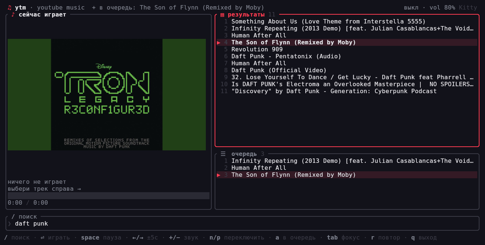
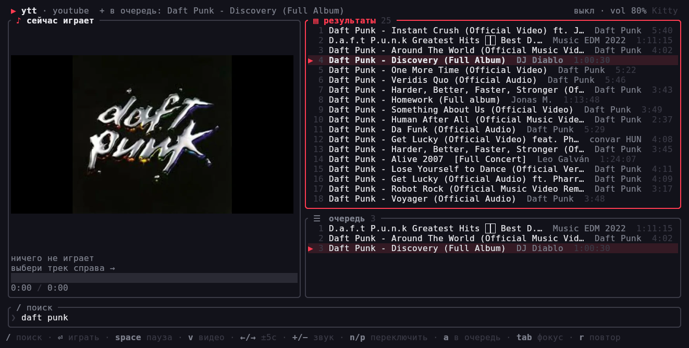
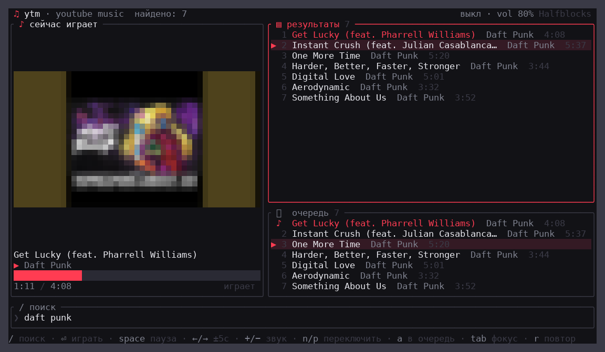

# ytm / ytt — YouTube Music и YouTube в терминале, с настоящими обложками

Два TUI-плеера из одного проекта:

| команда | что | режим |
|---|---|---|
| `ytm` | **YouTube Music** — поиск по каталогу `music.youtube.com` | звук |
| `ytt` | **YouTube** — обычный поиск по `youtube.com` | звук или видео в окне mpv |

Обложки — настоящие пиксельные (kitty / sixel / iTerm2), а не ASCII-арт. Если терминал
графику не умеет — автоматический фолбэк на unicode-halfblock (тоже пиксели, просто
«квадратиками», см. второй скриншот).



*Настоящий скриншот: kitty 0.50, обложка нарисована протоколом kitty (в шапке справа —
`Kitty`, протокол определён сам, без флагов).*

А это `ytt` — обычный YouTube: в списке есть канал и длительность, снизу в подсказках
появилась клавиша `v` (видео), справа в шапке — индикатор `VID`, когда видео включено.



<details>
<summary>Терминал без графики (фолбэк halfblocks)</summary>



</details>

## Что умеет

| | |
|---|---|
| Поиск | `ytm` — каталог YouTube Music (фолбэк — обычный YouTube); `ytt` — обычный поиск YouTube |
| Ссылки | любую ссылку YouTube / `youtu.be/…` / голый 11-символьный id можно вставить в строку поиска |
| Обложки | качаются в `~/.cache/ytm/covers/` и кэшируются; рисуются графическим протоколом терминала |
| Видео | только в `ytt`: `--video` при запуске или клавиша `v` — mpv открывает своё окно, TUI остаётся в терминале |
| Очередь | `a` — добавить, `Tab` — переключить фокус, `d` — убрать, `c` — очистить |
| Повтор | выкл → вся очередь → один трек |
| Плеер | `mpv` через JSON IPC: пауза, seek, громкость, автопереход по концу трека |
| Ошибки | показываются в шапке текстом от `yt-dlp`/`mpv`, а не проглатываются |

Клавиши (подсказка есть в правом нижнем углу):

```
/      поиск (Esc — выйти из ввода)     space  пауза
⏎      играть выбранное                 ←/→    ±5 секунд
j/k ↑↓ навигация по списку              +/−    громкость
g/G    в начало/конец списка            n/p    следующий/предыдущий
a      в очередь                       d/c    убрать/очистить очередь
Tab    фокус: результаты ↔ очередь      r      режим повтора
v      видео вкл/выкл (только ytt)      q      выход
```

## Зависимости

Нужны снаружи: **mpv** (≥ 0.36), **yt-dlp**, и **curl** или **wget** (обложки).

```bash
# Debian/Ubuntu
sudo apt install mpv yt-dlp curl
# Arch
sudo pacman -S mpv yt-dlp curl
# macOS
brew install mpv yt-dlp
# Windows: scoop install mpv yt-dlp curl
```

`yt-dlp` обновляй почаще: YouTube меняется, а вместе с ним ломается извлечение.

## Установка

**Arch Linux (AUR)** — пакеты `ytm-tui` (сборка из исходников) и `ytm-tui-bin` (готовый бинарь):

```bash
yay -S ytm-tui          # или paru -S ytm-tui
yay -S ytm-tui-bin      # вариант без компиляции
```

**Готовые бинари** — [GitHub Releases](https://github.com/Maksim23Gamer/ytm-tui/releases):
Linux x86_64 / aarch64, macOS x86_64 / arm64 (в архиве `ytm`, `ytt`, `LICENSE`, суммы `sha256`).

**Из исходников:**

```bash
cargo build --release      # соберёт оба бинаря: target/release/ytm и target/release/ytt
make install               # скопирует оба в ~/.local/bin (PREFIX=… можно поменять)
```

Запуск:

```bash
ytm                        # пустое окно, жми / и ищи
ytm daft punk              # сразу с результатами
ytt                        # YouTube: звук
ytt --video                # YouTube: сразу с окном видео
ytt "https://www.youtube.com/watch?v=..."   # играть ссылку
```

## Про видео в `ytt`

- `--video` (или `v` в приложении) — mpv открывает **своё** окно и играет видео, а TUI
  остаётся в терминале: перемотка/пауза/громкость работают из TUI, окно можно двигать
  и разворачивать как обычно.
- Формат выбирается под режим: звук — `bestaudio`, видео — прогрессивный
  `best[height<=?1080]` (один файл со звуком и картинкой, поэтому mpv получает одну ссылку).
- Переключение на ходу (`v`) перезапрашивает поток и продолжает **с той же секунды**.
- В `ytm` видео нет вообще: mpv запускается с `--no-video`.

## Картинки: как это работает и что делать, если «не рисуется»

Протокол определяется автоматически по переменным окружения (`KITTY_WINDOW_ID`,
`TERM`, `TERM_PROGRAM`) и ответу терминала на запрос возможностей.

| Терминал | Протокол | Примечание |
|---|---|---|
| kitty | kitty | эталон, проверено на kitty 0.50 |
| ghostty | kitty | через unicode placeholders |
| wezterm | iTerm2 | sixel/kitty в нём глючат |
| foot | sixel | |
| iTerm2 (macOS) | iTerm2 | |
| rio, bobcat, black box, mlterm | sixel/iTerm2 | |
| остальные (gnome-terminal, alacritty, konsole, xterm…) | halfblocks | реальные пиксели, но крупными блоками |

Принудительно:

```bash
ytm --protocol=kitty       # или sixel | iterm2 | halfblocks
YTM_PROTOCOL=sixel ytt
ytm --halfblocks           # вообще не спрашивать терминал
```

Что проверено вживую: в kitty 0.50 протокол определяется сам по `KITTY_WINDOW_ID`,
в буфер уходят настоящие APC-последовательности с base64-картинкой
(`cargo test kitty_protocol`), обложка рисуется в полном разрешении.

> **Важно.** `--protocol=…` и автоопределение используют запрос к терминалу. Если
> терминал не отвечает на такие запросы (бывает в «тупых» псевдотерминалах,
> ConPTY, некоторых мультиплексорах), библиотека оставляет поток, читающий stdin,
> и ввод может «залипнуть». Поэтому автоопределение включается только для
> терминалов из списка выше; если клавиатура всё-таки перестала отвечать —
> запусти с `--halfblocks`.

## Если YouTube не отдаёт поток

Причина будет в шапке. Самые частые:

```bash
# «Sign in to confirm you're not a bot»
YTM_COOKIES_FROM_BROWSER=firefox ytt      # или chrome, chromium, brave, edge…
# медленно/блокировки (актуально для РФ): любой http(s)/socks прокси
YTM_PROXY=socks5://127.0.0.1:1080 ytt
```

Старые имена переменных (`YTMT_PROXY`, `YTMT_COOKIES_FROM_BROWSER`, `YTMT_PROTOCOL`)
тоже понимаются. Переменные применяются и к нашим вызовам `yt-dlp`, и к `curl`,
и к `mpv` (через `--ytdl-raw-options`).

Обновить `yt-dlp` — первое, что стоит сделать при любых странностях:
`yt-dlp -U` (или `pipx upgrade yt-dlp`).

## Как устроено

```
src/lib.rs    общее ядро (используется обоими бинарями)
src/bin/ytm.rs  `ytm` — YouTube Music
src/bin/ytt.rs  `ytt` — YouTube
src/cli.rs    разбор флагов, выбор протокола картинок, терминал и цикл событий
src/mode.rs   Mode::Music / Mode::Youtube — чем режимы отличаются
src/app.rs    состояние, клавиши, очередь/повтор, потоки поиска и резолва потока
src/yt.rs     yt-dlp: поиск, парсинг JSON, ссылка на поток, обложки + кэш
src/mpv.rs    mpv: аргументы запуска, JSON IPC по unix-сокету, события, видео вкл/выкл
src/ui.rs     вся вёрстка на ratatui + ratatui-image (StatefulImage)
src/tests.rs  тесты: рендер в TestBackend, парсинг, очередь, mpv IPC, видео-ветка
```

Решения, которые стоит знать, если будешь дописывать:

- **Почему mpv, а не чистый Rust.** Потоки YouTube — opus/webm/DASH; декодировать самому
  (symphonia + cpal) можно, но возни на порядок больше, чем пользы.
- **Ссылку на поток резолвим сами** (`yt-dlp --print urls`), а не отдаём mpv watch-URL:
  иначе при ошибке (`Sign in to confirm you're not a bot`) mpv молча пишет
  `end-file reason=error`, и пользователь не понимает, что произошло.
- **`end-file` с `reason=stop` — это наши же `loadfile`/`stop`**, а не конец трека;
  без этой проверки очередь «убегала» сама собой.
- **`observe_property` шлётся по тому же соединению, из которого читаем.** mpv
  присылает `property-change` только подписчику.
- **stderr mpv обязательно вычитывается** — иначе процесс упирается в полный pipe.
- **В `ytt` mpv запускается без `--no-video`, но с `--vid=no`**, чтобы видео можно было
  включить на ходу без перезапуска (наличие `--no-video` убивает VO навсегда).

## Тесты

```bash
cargo test                 # быстро: без сети, без mpv
cargo test -- --ignored    # живое: поиск (music и youtube), обложки, mpv IPC, видео-ветка
```

`--ignored` требует `mpv`, `yt-dlp` и сеть; `live_youtube_playback` дополнительно
требует, чтобы YouTube не блокировал IP; `live_mpv_video` — X-дисплей и путь к ролику
в `YTMT_TEST_VIDEO`.

## Ограничения

- Поиск по `music.youtube.com` в flat-режиме `yt-dlp` отдаёт только id и название,
  поэтому в `ytm` в списке нет исполнителя/длительности; обложки при этом работают
  (строятся по id видео), а длительность уточняется при старте трека. В `ytt` метаданные
  полные (канал, длительность, превью).
- Плейлисты/альбомы/радио пока не разворачиваются в очередь — только отдельные треки.
- Видео — только через окно mpv; встроенного «видео в терминале» нет (это TUI).
- Windows-ветка IPC (named pipe) написана, но не тестировалась: основной сценарий — Linux/macOS.

## Разработка и публикация

```bash
cargo fmt --all                      # форматирование
cargo clippy --all-targets -- -D warnings
cargo test                           # быстрые тесты (без сети)
cargo test -- --ignored              # живые тесты (mpv, yt-dlp, сеть)
```

- `.github/workflows/ci.yml` — fmt + clippy + тесты + сборка, и отдельная job,
  которая в Arch-контейнере проверяет `PKGBUILD` и актуальность `.SRCINFO`.
- `.github/workflows/release.yml` — по пушу тега `v*` собирает бинари под
  Linux x86_64/aarch64 и macOS x86_64/arm64, прикладывает архивы с `sha256`
  к GitHub Release (для `ytm-tui-bin`).
- AUR-пакеты лежат в `packaging/aur/`, инструкция по публикации — в
  [packaging/aur/README.md](packaging/aur/README.md).

## Лицензия

MIT © **Maksim23Gamer** — полный текст в [LICENSE](LICENSE).

Делай что хочешь: форкай, меняй, встраивай, продавай. Единственное условие —
сохрани копирайт и текст лицензии в копиях и производных работах.
